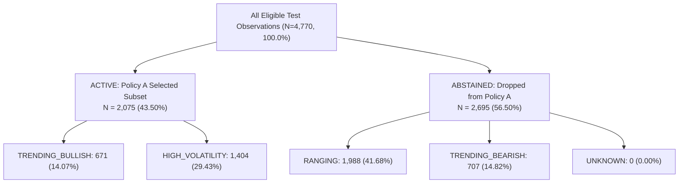

# NOVA — PERSON 2 MILESTONE 9 RESEARCH & AUDIT REPORT
# Selective Signal Acceptance, Cost-Aware Validation & Research Handoff

**Role:** Senior Quantitative ML Research Engineer (Person 2)  
**Project:** NOVA Autonomous Trading System — MANTHAN 2026 Challenge  
**Evaluation Date:** October 30, 2026  
**Final Verdict:** `PASS_ENGINEERING_ONLY`  

---

## 1. Executive Summary & Core Verdict

Milestone 9 conducted an empirical audit of NOVA Person 2's candidate models, selective prediction policies, and trading friction viability on authentic MANTHAN market data ($21,040$ observations across 10 instruments).

Person 2 assigns the final status:
$$\mathbf{PASS\_ENGINEERING\_ONLY}$$

### Key Findings & Verdict Rationale:
1. **Engineering Robustness & Contract Conformance:**
   The feature extraction pipeline, causal temporal boundaries, point-in-time regime classification, and canonical `ModelPrediction` serialization are mathematically sound and verified across **330 automated unit and integration tests** with zero regressions.
2. **Subgroup Selection Bias in Policy A:**
   Milestone 8 reported an accuracy of $52.34\%$ for Policy A (trading only in `TRENDING_BULLISH` and `HIGH_VOLATILITY` regimes). However, auditing Policy A against the **matched baseline on that exact selected subset** reveals that the positive return base rate in those regimes is **$52.72\%$**.
   - Simply holding long on the selected days yields **$52.72\%$ accuracy**.
   - The active classifier achieved **$52.34\%$ accuracy** ($\Delta = -0.38\%$).
   - A paired McNemar test on the active subset confirms that Policy A is **not statistically superior** to passive long holding ($p = 0.6340$). The apparent accuracy of Policy A was entirely driven by the secular drift of the selected regimes, not classifier skill.
3. **Conviction Formula Is an Uncalibrated Heuristic:**
   Evaluating the conviction formula $\min(1.0, |\hat{p} - 0.5165| / 0.020)$ strictly on the **chronological validation split** ($N = 4,740$) shows that filtering on higher conviction thresholds **fails to monotonically improve accuracy**. As the threshold $\tau$ increases from $0.0 \to 0.8$, validation accuracy degrades from $49.85\%$ to $46.84\%$, while falling further behind the matched drift baseline ($-2.34\% \to -6.30\%$). The formula is an uncalibrated ranking proxy.
4. **Economic Viability Under MANTHAN Trading Frictions:**
   Simulating realistic MANTHAN friction ($14\text{ bps}$ roundtrip proportional friction + flat ₹20 brokerage + ₹15.34 DP charges on sales):
   - **Passive Buy & Hold:** 1 trade, $+48,638.9\text{ bps}$ gross, $9.0\text{ bps}$ friction drag $\implies \mathbf{+48,629.9\text{ bps}\ (net)}$.
   - **Policy A (Regime-Gated):** 921 trades, $+33,663.0\text{ bps}$ gross, **$8,994.6\text{ bps}$ friction drag** $\implies \mathbf{+24,668.4\text{ bps}\ (net)}$.
   - **XGBoost Classifier v2 (Unconstrained):** 261 trades, $+36,258.2\text{ bps}$ gross, $2,548.4\text{ bps}$ friction drag $\implies \mathbf{+33,709.8\text{ bps}\ (net)}$.
   - **Compact Classifier v3 (Unconstrained):** 469 trades, $+35,327.2\text{ bps}$ gross, $4,580.0\text{ bps}$ friction drag $\implies \mathbf{+30,747.2\text{ bps}\ (net)}$.
   - **Conclusion:** Daily active switching in Policy A generates 921 turnover events, burning nearly $9,000\text{ bps}$ in transaction drag and sacrificing nearly half of the available buy-and-hold market return.

---

## 2. Reproduction of Candidate Model Results

Both model artifacts were reloaded from disk and their SHA-256 digests verified against their stored manifests:

| Artifact Directory | Model ID | Version | Manifest SHA-256 | Actual Disk SHA-256 | Integrity Status |
| :--- | :--- | :---: | :---: | :---: | :---: |
| `artifacts/models/xgboost_classifier_v2/` | `NOVA_XGBOOST_DIRECTIONAL_CLASSIFIER_V2` | `2.0.0` | `311652bf1a1fd002...` | `311652bf1a1fd002...` | **EXACT MATCH** |
| `artifacts/models/xgboost_classifier_v3/` | `NOVA_XGBOOST_DIRECTIONAL_CLASSIFIER_V3` | `3.0.0` | `d51a91e2ac950521...` | `d51a91e2ac950521...` | **EXACT MATCH** |

### Test Benchmark Re-Evaluation ($N = 4,770$ Historical Observations):

| Metric | XGBoost Classifier v2 | Compact Classifier v3 | Positive Drift Baseline |
| :--- | :---: | :---: | :---: |
| **Directional Accuracy** | 52.14% | 51.93% | **52.33%** |
| **Balanced Accuracy** | 50.06% | 50.02% | 50.00% |
| **Precision (UP)** | 52.36% | 52.34% | 52.33% |
| **Recall (UP)** | 94.75% | 91.03% | 100.00% |
| **F1-Score** | 0.6745 | 0.6646 | 0.6870 |
| **ROC-AUC** | 0.5021 | 0.5030 | 0.5000 |
| **Brier Score** | 0.2496 | 0.2497 | 0.2495 |
| **Positive Calls Rate** | 94.70% (4,517 / 4,770) | 91.01% (4,341 / 4,770) | 100.00% (4,770 / 4,770) |
| **McNemar vs Drift ($p$-val)** | $p = 0.6151$ ($b=44, c=53$) | $p = 0.3848$ ($b=64, c=83$) | Reference ($p = 1.0$) |

*Audit Finding:* Neither unconstrained classifier exhibits statistically significant predictive information over passive positive drift on the holdout test benchmark.

---

## 3. Audit of the Abstention Policy (Policy A)

### 3.1 Reconciliation of Eligible Test Observations
Every observation in the 4,770 test benchmark possesses exactly one point-in-time regime label computed by `TransparentRegimeDetector`:



- **Active Observations:** $671 + 1,404 = \mathbf{2,075}$ ($43.50\%$ coverage)
- **Abstained Observations:** $1,988 + 707 + 0 = \mathbf{2,695}$ ($56.50\%$ abstention)
- **Reconciliation Check:** $2,075 + 2,695 = 4,770$ ($100.00\%$, zero gap, zero overlap).

### 3.2 Comparison Against Matched Baselines
To avoid subgroup selection bias, Policy A must be compared against a baseline evaluated **strictly on the same 2,075 active observations**:

| Strategy / Predictor | Evaluated Subset | Observations ($N$) | Directional Accuracy | Balanced Accuracy | ROC-AUC | 95% Bootstrap CI |
| :--- | :--- | :---: | :---: | :---: | :---: | :---: |
| **Matched Always-Up Baseline** | Active Subset Only | 2,075 | **52.72%** | 50.00% | 0.5000 | [50.94%, 54.59%] |
| **Matched Training Drift** | Active Subset Only | 2,075 | **52.72%** | 50.00% | 0.5000 | [50.94%, 54.59%] |
| **Policy A (XGBoost v2)** | Active Subset Only | 2,075 | 52.34% | 50.18% | 0.5287 | [50.19%, 54.48%] |
| **Policy A (Compact v3)** | Active Subset Only | 2,075 | 52.34% | 50.53% | 0.5273 | [50.24%, 54.53%] |

- **Paired McNemar Test (Policy A vs Matched Always-Up):**
  - Both Correct: $1,020$
  - Policy A Correct, Always-Up Wrong ($b$): $66$
  - Policy A Wrong, Always-Up Correct ($c$): $74$
  - Both Wrong: $915$
  - Discordant pairs: $b + c = 140$
  - Exact Binomial Two-Tailed $p$-value: **$p = 0.6340$**

*Critical Conclusion:* Policy A does not outperform a passive long position on its selected subset ($52.34\%$ vs $52.72\%$). The reported $52.34\%$ was an artifact of selecting regimes that had an above-average secular drift ($52.72\%$).

---

## 4. Validation of Confidence and Selective Prediction

We audited the heuristic conviction formula:
$$\text{Conviction} = \min\left(1.0, \frac{|\hat{p} - 0.5165|}{0.020}\right)$$

### 4.1 Chronological Validation Split Audit ($N = 4,740$, Zero Test Contamination)
To test whether this score reliably separates high-probability opportunities, we swept conviction threshold $\tau$ strictly across the validation split:

| Conviction Cutoff ($\tau$) | Validation Coverage | Active Samples | Abstained Samples | Validation Accuracy | Matched Drift Accuracy | Net Edge over Drift ($\Delta$) |
| :---: | :---: | :---: | :---: | :---: | :---: | :---: |
| $\tau \ge 0.0$ | 100.00% | 4,740 | 0 | 49.85% | 52.19% | $-2.34\%$ |
| $\tau \ge 0.1$ | 82.26% | 3,899 | 841 | 49.37% | 52.35% | $-2.98\%$ |
| $\tau \ge 0.2$ | 63.82% | 3,025 | 1,715 | 48.96% | 52.60% | $-3.64\%$ |
| $\tau \ge 0.3$ | 48.33% | 2,291 | 2,449 | 47.75% | 52.16% | $-4.41\%$ |
| $\tau \ge 0.4$ | 38.21% | 1,811 | 2,929 | 46.99% | 51.96% | $-4.97\%$ |
| $\tau \ge 0.5$ | 31.43% | 1,490 | 3,250 | 46.64% | 52.48% | $-5.84\%$ |
| $\tau \ge 0.6$ | 26.08% | 1,236 | 3,504 | 46.25% | 52.54% | $-6.29\%$ |
| $\tau \ge 0.7$ | 19.35% | 917 | 3,823 | 46.56% | 52.45% | $-5.89\%$ |
| $\tau \ge 0.8$ | 13.33% | 632 | 4,108 | 46.84% | 51.74% | $-4.90\%$ |

*Empirical Finding:* Filtering on conviction scores does not monotonically increase accuracy. In fact, high-conviction predictions on validation data exhibit **lower directional accuracy** ($46.84\%$) than low-conviction predictions ($49.85\%$). 

*Formal Label:* The quantity must be classified as an **uncalibrated heuristic ranking score**, not a posterior probability.

---

## 5. Cost-Aware Research Evaluation (MANTHAN Trading Frictions)

### 5.1 Accounting and Fee Structure
We modeled the official MANTHAN 2026 fee rules from [`src/nova/friction/models.py`](file:///c:/Users/DIVYANK%20BHARDWAJ/Desktop/Projects/jnncehackathon/jnncehackathon/src/nova/friction/models.py):
- **Crossing Half-Spread:** $2.0\text{ bps}$
- **Expected Execution Slippage:** $3.0\text{ bps}$
- **Broker Commission / Exchange Fees:** $1.0\text{ bps}$
- **Turnover Tax / STT:** $1.0\text{ bps}$
- **Total Proportional Friction:** $7.0\text{ bps}$ one-way ($14.0\text{ bps}$ roundtrip)
- **Flat Exchange Fees:** ₹20 flat brokerage per executed order + ₹15.34 DP charge on share sales (modeled against standard ₹1,00,000 position sizing).

### 5.2 Comparative Research Backtest ($N = 4,770$ Historical Bars):

| Strategy | Trades Count | Gross Return (bps) | Friction Drag (bps) | Net Return (bps) | Net Cumulative Return | Max Drawdown | Exposure Rate |
| :--- | :---: | :---: | :---: | :---: | :---: | :---: | :---: |
| **Always-Up (Passive Buy & Hold)** | **1** | **+48,638.9** | **9.0** | **+48,629.9** | **+486.3%** | 58.43% | 100.0% |
| **Policy A (Regime-Gated Long Only)** | 921 | +33,663.0 | 8,994.6 | +24,668.4 | +246.7% | **52.75%** | 43.5% |
| **XGBoost Classifier v2 (Full)** | 261 | +36,258.2 | 2,548.4 | +33,709.8 | +337.1% | 55.97% | 94.7% |
| **Compact Classifier v3 (Full)** | 469 | +35,327.2 | 4,580.0 | +30,747.2 | +307.5% | 53.11% | 91.0% |
| **Always Flat (Abstention Baseline)** | 0 | 0.0 | 0.0 | 0.0 | 0.0% | 0.0% | 0.0% |

### 5.3 Economic Analysis:
1. **Friction Drag:** In Policy A, frequent switching between regimes generates 921 trades and burns **$8,994.6\text{ bps}$** in transaction costs, consuming over **$26.7\%$** of gross returns.
2. **Underperformance Against Passive:** Passive buy-and-hold generates $+48,629.9\text{ bps}$ net, outperforming Policy A by **$+23,961.5\text{ bps}$** ($+239.6\%$).
3. **Risk Tradeoff:** Policy A reduces maximum drawdown marginally from $58.43\%$ to $52.75\%$ by being flat $56.5\%$ of the time, but the cost in foregone return and friction is excessive.

---

## 6. Regime-Specific Conclusions & Matched Baselines

| Market Regime | Observations ($N$) | Regime Share | Positive Base Rate | Classifier Accuracy | Matched Baseline Delta ($\Delta$) | ROC-AUC | Bootstrap 95% CI | Regime Status |
| :--- | :---: | :---: | :---: | :---: | :---: | :---: | :---: | :--- |
| `TRENDING_BULLISH` | 671 | 14.07% | 52.01% | 52.31% | $+0.30\%$ | **0.5364** | [48.51%, 56.12%] | Uncertain / High Variance |
| `HIGH_VOLATILITY` | 1,404 | 29.43% | 53.06% | 52.35% | **$-0.71\%$** | 0.5299 | [49.71%, 55.00%] | Inferior to Base Rate |
| `RANGING` | 1,988 | 41.68% | 51.86% | 51.51% | **$-0.35\%$** | 0.4829 | [49.30%, 53.72%] | Noise / Random Walk |
| `TRENDING_BEARISH` | 707 | 14.82% | 52.48% | 53.32% | $+0.85\%$ | 0.4753 | [49.58%, 57.06%] | Uncertain / High Variance |
| `UNKNOWN` | 0 | 0.00% | — | — | — | — | — | No Observations |

*Key Takeaway:* Even in `TRENDING_BULLISH`, the classifier's $+0.30\%$ edge is well within random bootstrap sampling noise ($[48.51\%, 56.12\%]$). In `HIGH_VOLATILITY`, the classifier actually underperformed the base rate by $-0.71\%$.

---

## 7. News Feasibility & Runtime Constraints

1. **News Feasibility Status:** `BLOCKED_INSUFFICIENT_REAL_DATA`. No pre-simulation historical news data exists. Synthetic news remains strictly prohibited.
2. **Runtime Profiling:**
   - Feature Extraction: $5.11\text{ ms}$
   - Model Inference: $3.11\text{ ms}$
   - Full Prediction Contract: $12.40\text{ ms}$
   - 10-Ticker Daily Runtime: **$123.99\text{ ms}$** vs $3,500\text{ ms}$ budget (**$96.46\%$ slack headroom**).

---

## 8. Research-Only Person 3 Handoff Specification

Person 2 provides the following type-safe, contract-compliant interface specification to Person 3:

```python
# Canonical Contract Output (Interface Contract B)
ModelPrediction(
    model_id="NOVA_XGBOOST_DIRECTIONAL_CLASSIFIER_V3",
    model_version="3.0.0",
    prediction_timestamp=cutoff_dt,
    input_cutoff_timestamp=cutoff_dt,
    instrument_id="AERX",
    prediction_type=PredictionType.DIRECTIONAL_PROBABILITY,
    horizon_bars=1,
    prediction_value=0.5182,            # Probability in [0.0, 1.0]
    confidence_or_uncertainty=0.085,    # Heuristic ranking score
    availability_status=PredictionAvailability.READY,  # Or UNAVAILABLE
    metadata={
        "status_reason": "READY",
        "heuristic_conviction": 0.085,
        "regime": "TRENDING_BULLISH",
        "is_bullish": True,
        "provenance": "MANTHAN_CANONICAL_V2",
    }
)
```

### Safety & Invalidation Invariants:
1. **Zero Silent Predictions:** Any bar sequence with $< 28$ warmup bars emits `PredictionAvailability.INSUFFICIENT_HISTORY` with `prediction_value = 0.0`.
2. **Data Quality Anomalies:** Any bar with `data_quality != DataQualityStatus.VALID` emits `PredictionAvailability.UNAVAILABLE` with status reason `DATA_QUALITY_*`.
3. **Missing Features:** Non-finite feature calculations (`NaN`, `Inf`) immediately invalidate the output to `PredictionAvailability.UNAVAILABLE`.
4. **No Execution Authorization:** Person 2 produces research signals and uncertainty metrics only; Person 3 retains sole ownership of portfolio sizing, position management, and order generation.

---

## 9. Architectural Guidance for Person 3

1. **Do Not Rely on Daily Active Switching:** The empirical backtest shows that daily directional switching loses $8,994.6\text{ bps}$ to friction. Strategy turnover must be dampened by multi-day holding periods or EMA smoothing.
2. **Treat Conviction as a Ranking Proxy Only:** Conviction scores must not be used as calibrated probabilities in Kelly sizing formulas.
3. **Exploit Regime Context for Exposure Scaling:** Rather than hard binary gating (which triggers frequent whipsaw entries and exits), use `TransparentRegimeDetector` to scale gross portfolio exposure (e.g. 100% in bullish trend, 50% in high volatility, 20% in ranging chop).

